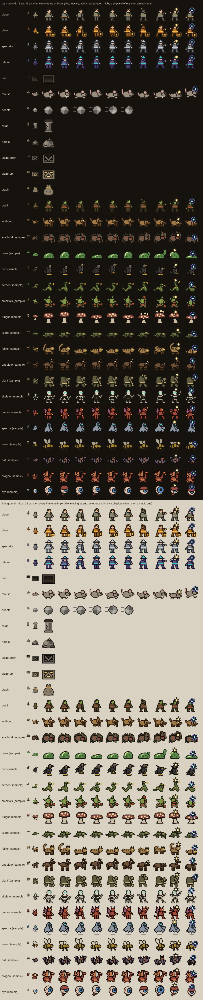

# content/sprites

SVG sprites for every Scarcity entity, drawn by category (humanoid, rodent, canine, the
creature categories of [`docs/categories.md`](docs/categories.md), stone, pillar, rubble,
stairs, stash) and recoloured per prototype by an appearance: a colour for each of the
category's paint slots, and overlays. The setting they follow is in [`docs/setting.md`](../../docs/setting.md);
the rules for drawing and the manifest are in [`AGENTS.md`](AGENTS.md).



## Use
```sh
npm ci
npm test               # validate the manifest, the sheets and prototype coverage
npm run preview        # writes preview.html: open it in a browser
npm run contact-sheet  # writes docs/contact-sheet.svg; render to PNG with rsvg-convert
npm run draw -- arachnid        # scripts/draw/arachnid.mjs writes the sheet and its manifest entry; then npm test and the sheet view
npm run sheet -- arachnid --png # only the sheet view, docs/sheet-arachnid.png: one category, every frame, beside the rest
```

A sprite is a `<use href="#<symbol id>">` of a symbol from a sheet, inside an
`<svg viewBox="-16 -16 32 32">` that sets the appearance's colours as CSS variables,
one per paint slot of the category (`--sprite-body`, `--sprite-outline`, ...; a
humanoid's are `--sprite-skin`, `--sprite-primary`, ...); the appearance's overlays
are further `<use>`s on top. `sprites.json` says which symbols make which state,
how long a frame lasts, which slots each category paints, and each prototype's
default appearance.

`npm test` also fails when a prototype in `libs/world-model` or `libs/world-seed`
has no appearance, so a new prototype needs a sprite before it merges.
